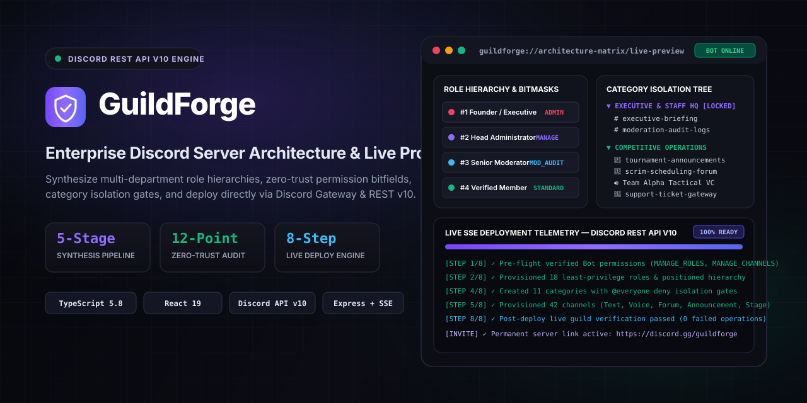
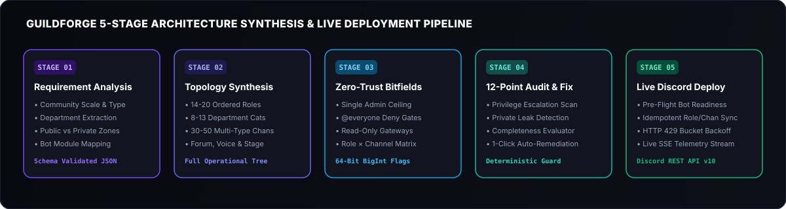

<div align="center">



<br />

# GuildForge

**Enterprise Discord Server Architecture Generator, Zero-Trust Permission Auditor & Live Discord REST API v10 Deployment Engine**

[](https://www.typescriptlang.org/)
[](https://react.dev/)
[](https://discord.com/developers/docs/intro)
[](https://tailwindcss.com/)
[](https://expressjs.com/)

</div>

---

## Overview

**GuildForge** is a full-stack Discord community architecture studio and live server provisioning platform. Instead of manually configuring dozens of roles, permission bitfields, category overwrites, and channels across complex Discord communities, GuildForge synthesizes complete, zero-trust server blueprints from natural-language specifications and deploys them directly to live Discord servers over **Discord REST API v10** and **Discord Gateway v10 WebSockets**.

---

## Architecture Synthesis & Provisioning Pipeline

<div align="center">
  
</div>

1. **Stage 1 — Requirement Analysis & Department Extraction**: Extracts community scale, security posture (`standard`, `high`, `maximum`), operational departments, leadership tiers, public vs. restricted zones, and required automation modules.
2. **Stage 2 — Topology & Channel Synthesis**: Generates ordered role hierarchies (14–20+ roles), department categories (8–13+ categories), and multi-modal channels (`GUILD_TEXT`, `GUILD_VOICE`, `GUILD_ANNOUNCEMENT`, `GUILD_FORUM`, `GUILD_STAGE_VOICE`, `GUILD_MEDIA`).
3. **Stage 3 — Zero-Trust Permission Engineering**: Computes 64-bit Discord permission bitmasks (`BigInt`), restricts `ADMINISTRATOR` exclusively to rank `#1`, locks down announcement/rules gateways, and enforces explicit `@everyone` deny (`VIEW_CHANNEL`, `CONNECT`) overwrites on all private categories and channels.
4. **Stage 4 — 12-Dimension Security & Completeness Audit**: Evaluates the blueprint against 12 structural and security rules plus a requirement-aware completeness engine, offering one-click deterministic auto-remediation.
5. **Stage 5 — 8-Step Idempotent Live Deployment**: Verifies bot guild readiness, reuses existing roles/categories/channels by name to prevent duplicates, applies rate-limit-safe backoff (`HTTP 429`), streams real-time Server-Sent Events (SSE) telemetry, and verifies the live server state post-deployment.

---

## Key Capabilities

| Module | Capabilities |
| :--- | :--- |
| **Blueprint Studio** | Natural language prompt synthesis with configurable community archetypes (Esports, SaaS/Dev, Web3, Education, Gaming, Creator), member scale slider, department selectors, ticket flow builders, voice bitrate/region settings, and automation module mapping. |
| **Visual Architecture Editor** | Full CRUD editor for categories, channels, and roles; drag/arrow reordering; channel-to-category movement; interactive **Role × Channel Effective Permission Matrix** with inheritance tracing (`Role Base` → `Category Overwrite` → `Channel Overwrite`); and live Discord Client Simulator. |
| **12-Point Security Auditor** | Detects privilege escalation risks, multiple `ADMINISTRATOR` roles, hierarchy inversions, exposed staff/log channels, writable announcement feeds, unmoderated public channels, orphaned channels, and missing department workflows—with **1-Click Auto-Fix**. |
| **Live Deployment Center** | Pre-flight bot permission readiness check (`MANAGE_ROLES`, `MANAGE_CHANNELS`, role hierarchy ceiling), idempotent 8-stage deployment engine, real-time SSE log console, failed-operation retry without duplication, and automated permanent `discord.gg` invite generation. |
| **Full Server Clear Engine** | One-click server wipe tool that removes all existing channels, categories, and custom roles below the bot's hierarchy ceiling (with an option to recreate a fresh `#general` landing channel) before provisioning a new architecture. |
| **Snapshots & Diff Engine** | Point-in-time immutable blueprint snapshots, structural side-by-side diff comparison (added/removed roles, categories, and channels), one-click rollback, and JSON blueprint import/export. |
| **Discord Gateway v10 Daemon** | Built-in WebSocket client (`wss://gateway.discord.gg/?v=10&encoding=json`) with automated heartbeating (`OP 1` / `OP 10` / `OP 11`), `IDENTIFY` presence (`ONLINE`), and live `GUILD_CREATE` discovery. |

---

## Project Structure

```text
├── public/
│   └── assets/
│       ├── guildforge-banner.svg        # Hero showcase banner
│       └── guildforge-architecture.svg  # 5-stage pipeline diagram
├── src/
│   ├── components/
│   │   ├── ui/
│   │   │   ├── Badge.tsx                # Status badges & surface cards
│   │   │   └── Button.tsx               # Action buttons with loading states
│   │   ├── AdminDashboard.tsx           # Real-time platform metrics & audit trail
│   │   ├── BackupsHub.tsx               # Snapshot manager, JSON import/export & diff viewer
│   │   ├── BotInviteModal.tsx           # OAuth2 bot invite generator & server creation modal
│   │   ├── BuilderView.tsx              # 5-stage blueprint synthesis & advanced config studio
│   │   ├── DeploymentHub.tsx            # 8-stage live Discord REST v10 deployment center
│   │   ├── Header.tsx                   # Top navigation bar & active server selector
│   │   ├── LandingPage.tsx              # Product overview & workflow showcase
│   │   ├── OverviewView.tsx             # Active workspace command center
│   │   ├── SecurityAuditor.tsx          # 12-dimension security & completeness auditor
│   │   ├── ServerPreviewEditor.tsx      # Interactive architecture editor & permission matrix
│   │   ├── SettingsView.tsx             # Bot token verification, guild sync & server wipe
│   │   └── Sidebar.tsx                  # Collapsible navigation & live bot gateway indicator
│   ├── services/
│   │   ├── ai.ts                        # Structured JSON schema synthesis & optimization
│   │   ├── apiClient.ts                 # Frontend REST & polling client
│   │   ├── deploymentEngine.ts          # 8-stage Discord provisioning & server clear engine
│   │   ├── discordApi.ts                # Discord REST API v10 client with 429 rate-limit backoff
│   │   ├── discordGateway.ts            # Discord Gateway v10 WebSocket presence manager
│   │   ├── storage.ts                   # Persistent JSON disk database (data/guildforge-db.json)
│   │   └── validator.ts                 # 12-point zero-trust validator & auto-remediation engine
│   ├── types/
│   │   └── discord.ts                   # 64-bit Discord permission flags & blueprint schemas
│   ├── App.tsx                          # Root application state & view router
│   ├── index.css                        # Dark obsidian theme tokens & scrollbar styles
│   └── main.tsx                         # React 19 DOM entry point
├── server.ts                            # Express API server, SSE stream & Vite middleware
├── package.json                         # Dependencies & build scripts
├── tsconfig.json                        # TypeScript compiler configuration
└── vite.config.ts                       # Vite bundler configuration
```

---

## Getting Started

### Prerequisites

- **Node.js** `v20+` (or **Bun** `v1.1+`)
- A **Discord Application & Bot Token** from the [Discord Developer Portal](https://discord.com/developers/applications)
- A **Gemini API Key** for automated blueprint synthesis

### 1. Clone & Install Dependencies

```bash
git clone https://github.com/your-username/guildforge.git
cd guildforge
npm install
```

### 2. Configure Environment Variables

Copy `.env.example` to `.env` and populate your credentials:

```bash
cp .env.example .env
```

```env
GEMINI_API_KEY="your_gemini_api_key"
APP_URL="http://localhost:3000"
DISCORD_BOT_TOKEN="your_discord_bot_token"
DISCORD_CLIENT_ID="your_discord_application_client_id"
```

> **Note:** You can also configure and verify your `DISCORD_BOT_TOKEN` and `DISCORD_CLIENT_ID` directly inside the **Settings** or **Deployments** tab in the web interface, which persists them to `data/guildforge-db.json`.

### 3. Run in Development Mode

```bash
npm run dev
```

The Express + Vite server will start on `http://localhost:3000` and automatically connect your configured Discord Bot to the Discord Gateway v10 WebSocket.

### 4. Build for Production

```bash
npm run build
npm run start
```

---

## Discord Bot Setup Guide

1. Visit the [Discord Developer Portal](https://discord.com/developers/applications) and create a new Application.
2. Navigate to the **Bot** tab, click **Reset Token**, and copy your Bot Token.
3. Paste the Bot Token into **GuildForge → Settings → Discord Bot Credentials** and click **Verify & Sync**.
4. Click **Invite Bot** in the top navigation bar to generate an OAuth2 authorization URL (`permissions=8` for `Administrator` or `Manage Roles` + `Manage Channels`) and invite the bot to your target Discord server.
5. Important: In your Discord Server Settings → **Roles**, ensure the bot's role is positioned **above** any existing roles you want it to manage or clear.

---

## License

Released under the **Apache-2.0 License**.
